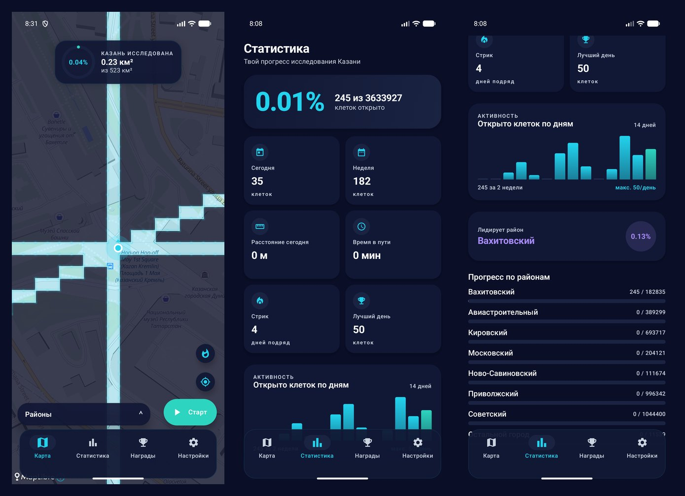

# CityFog

A personal Android app that turns walking around Kazan into a game. The city map is covered
in "fog of war". As you walk, cycle or ride a scooter, GPS opens the 12 × 12 m cells you pass
through, and the app counts what share of the city, and of each district, you have explored.
Everything stays on the phone: no server, no account.



*Emulator screenshots of the June 2026 build, with test data. The UI was redesigned in July.*

> **Status: working prototype.** Tracking, the fog, statistics, achievements and CSV export
> work. Offline maps and manual editing of unreachable cells are not done yet. Not
> published in an app store.
>
> **How this was made.** The idea, the game rules and the key decisions are mine: they are
> in my original brief, [`docs/brief.ru.md`](docs/brief.ru.md) (in Russian). Most of the
> code was written by AI coding assistants.

## How it works

**What counts as 100 %.** A city is not 100 % walkable: rivers, factories, military and
private land are closed. A Python pipeline in [`tools/`](tools/) reads OpenStreetMap data
once, takes the city boundary and its districts, subtracts water, industrial, military and
private areas, and rasterises the result with OpenCV into a mask: one pixel = one cell, the
value = the district. That leaves **3,633,927 reachable cells, 523 km²**, the denominator of
the percentage.

**Grid.** A local equirectangular projection around Kazan with 12 m cells: city GPS is not
precise enough for smaller ones. The grid is defined once in
[`tools/grid_config.py`](tools/grid_config.py), and the Kotlin
[`GridMapper`](android/app/src/main/java/ru/cityfog/grid/GridMapper.kt) must match it
exactly, or the mask pixels stop lining up with the cells on the phone.

**On the phone.**
- The mask ships in the APK as a raw 3233 × 3525 `uint8` array (11.4 MB, deflated in the
  APK); checking a cell is an O(1) array lookup, no geometry.
- A foreground location service records the walk and restarts after a reboot.
- Opened cells go to an append-only binary file, 16 bytes each: cell id and first-visit time.
- The fog is a dark polygon with holes cut where you have been. Neighbouring cells are merged
  into rectangles to keep the polygon small, and a glow is drawn only along the outer edge
  of the explored area.
- Screens: map with a district panel, statistics (today, week, month, streak, best day,
  a 14-day activity chart, progress by district), achievements, settings with CSV export.

## Building

```powershell
cd android
.\gradlew.bat :app:assembleDebug     # APK: android/app/build/outputs/apk/debug/app-debug.apk
```

The mask is already in `android/app/src/main/assets/`. To rebuild it from OpenStreetMap,
see [`tools/README.md`](tools/README.md) (in Russian).

## Stack

Kotlin · Jetpack Compose · MapLibre Native · Android foreground services · Python (pyrosm,
Shapely, OpenCV, NumPy) for the OpenStreetMap preprocessing

## Credits

- Map data © [OpenStreetMap](https://www.openstreetmap.org/copyright) contributors (ODbL);
  the availability mask is derived from it.
- Map tiles: [OpenFreeMap](https://openfreemap.org/), style "liberty".
- Map rendering: [MapLibre Native](https://github.com/maplibre/maplibre-native) (BSD 2-Clause).
- Fonts: Manrope, Unbounded, JetBrains Mono (SIL Open Font License 1.1).

## License

My code is under the [MIT License](LICENSE). The bundled fonts keep their own licence, and the
availability mask in `android/app/src/main/assets/` is derived from OpenStreetMap data and
is available under the ODbL.
